<div align="center">


<a href="https://github.com/akaanakbaik">
  
</a>

<br />

<a href="https://github.com/akaanakbaik?tab=followers"></a>&nbsp;
<a href="https://github.com/akaanakbaik"></a>&nbsp;
<a href="https://github.com/akaanakbaik"></a>&nbsp;
<a href="https://github.com/akaanakbaik/akaanakbaik/actions/workflows/profile-metrics.yml"></a>&nbsp;
<a href="https://github.com/akaanakbaik/akaanakbaik/actions/workflows/readme-health.yml"></a>

<br />

<a href="https://t.me/akamodebaik"></a>&nbsp;
<a href="https://www.instagram.com/kenal.aka"></a>&nbsp;
<a href="mailto:furinabyaka@gmail.com"></a>

</div>

---

## About

```ts
const aka = {
  name: "Aka",
  username: "akaanakbaik",
  location: "Sumatra Barat, Indonesia 🇮🇩",
  role: "Student Developer",
  focus: ["Web Development", "Linux", "Automation", "AI", "Bots", "Cloud"],
  motto: "still water, flowing. — air tenang menghanyutkan"
};
```

I build practical projects while learning: web apps, bot systems, Linux/VPS tools, automation, and AI-powered experiments.

---

## Live Profile Snapshot

<div align="center">

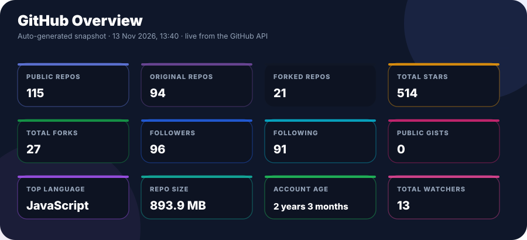

<br />

<a href="https://github.com/akaanakbaik"></a>&nbsp;
<a href="https://github.com/akaanakbaik"></a>&nbsp;
<a href="https://github.com/akaanakbaik"></a>&nbsp;
<a href="https://github.com/akaanakbaik"></a>&nbsp;
<a href="https://github.com/akaanakbaik"></a>

</div>

> Verified GitHub API snapshot · Updated by the profile metrics workflow · Figures reflect the last successful publication, not real-time activity.

---

## Language Engineering

<div align="center">

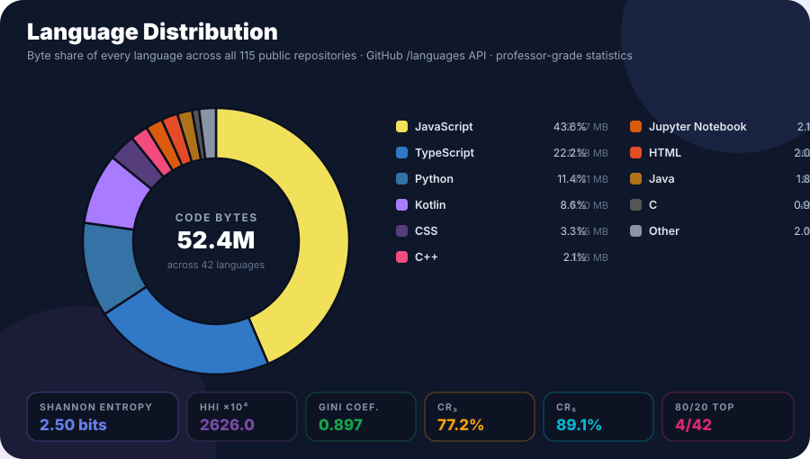

<br />
<br />

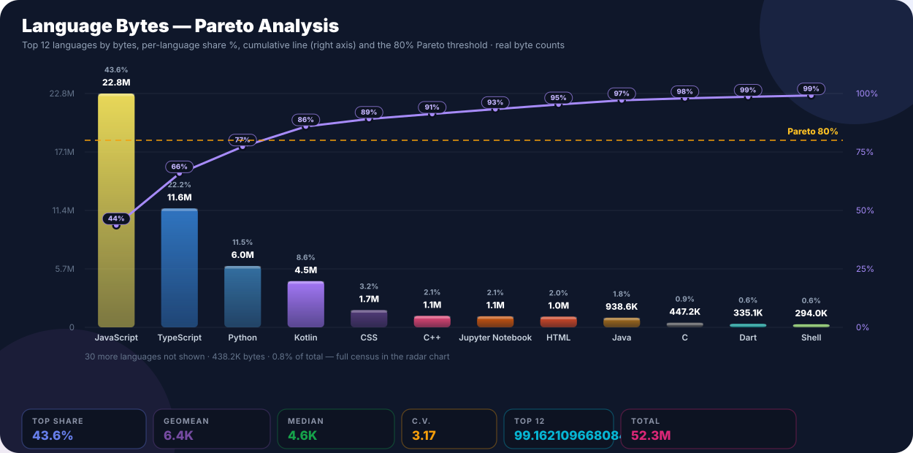

</div>

> Source: GitHub repository language-byte statistics.

---

## Code Census

<div align="center">

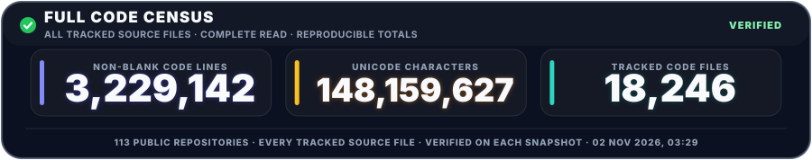

<br />

<p align="center">
  <a href="https://github.com/akaanakbaik"></a>&nbsp;
  <a href="https://github.com/akaanakbaik"></a>&nbsp;
  <a href="https://github.com/akaanakbaik"></a>

  <a href="https://github.com/akaanakbaik"></a>&nbsp;
  <a href="https://github.com/akaanakbaik"></a>&nbsp;
  <a href="https://github.com/akaanakbaik"></a>&nbsp;
  <a href="https://github.com/akaanakbaik"></a>&nbsp;
  <a href="https://github.com/akaanakbaik"></a>&nbsp;
</p>

</div>

### Repository Portfolio Signals

<div align="center">

<p align="center">
  <a href="https://github.com/akaanakbaik"></a>&nbsp;
  <a href="https://github.com/akaanakbaik"></a>&nbsp;
  <a href="https://github.com/akaanakbaik"></a>&nbsp;
  <a href="https://github.com/akaanakbaik"></a>
</p>

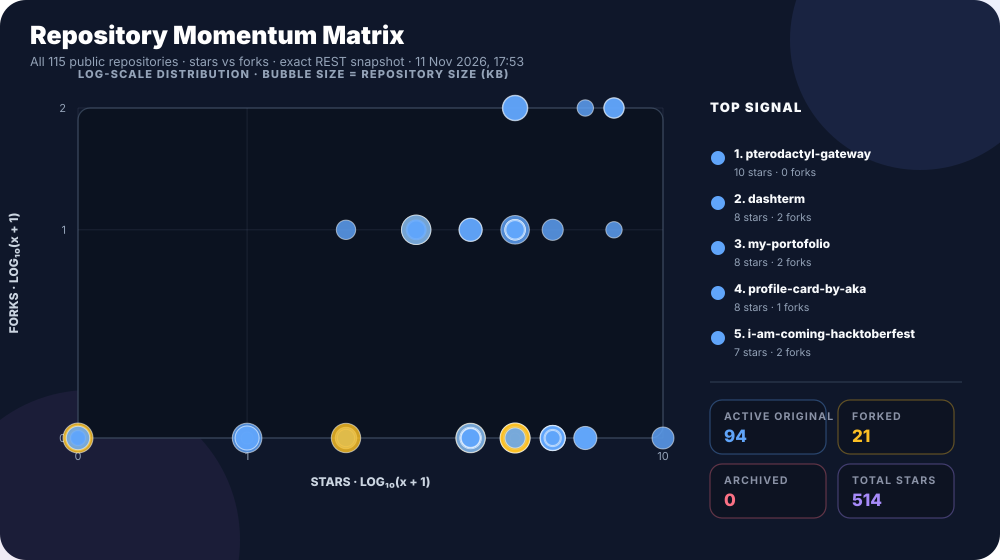

</div>

> Tracked source files across public repositories · Non-empty lines and Unicode characters · Validated before publication.

---

## Census Distribution

<div align="center">

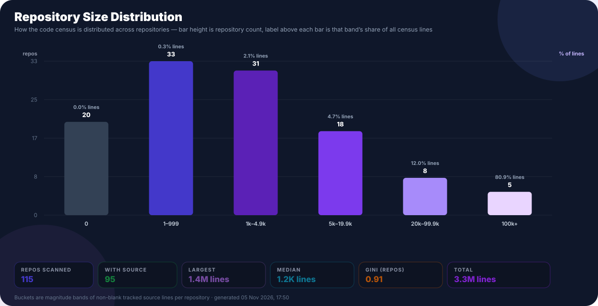

<br />
<br />

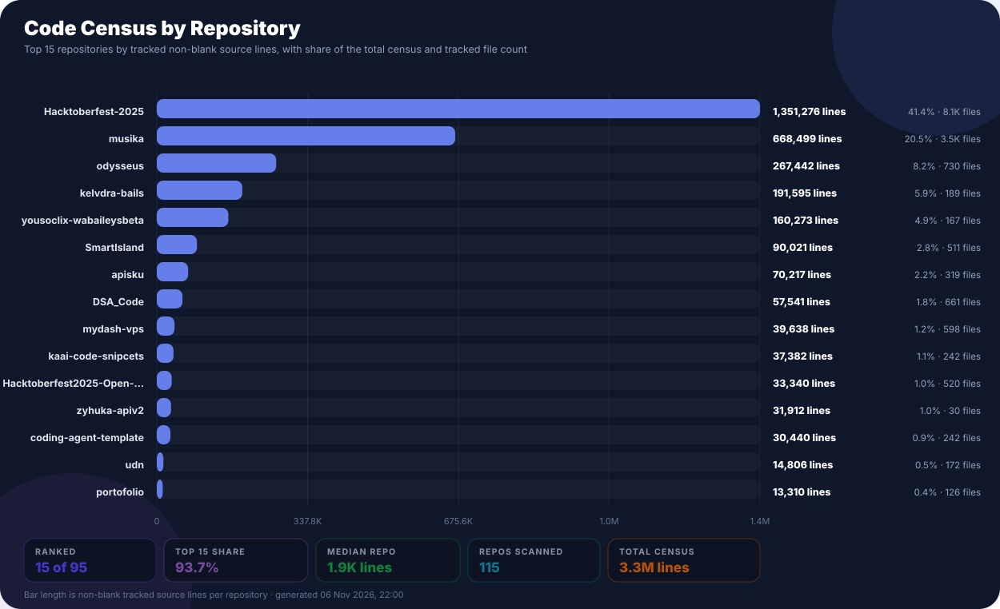

<br />
<br />

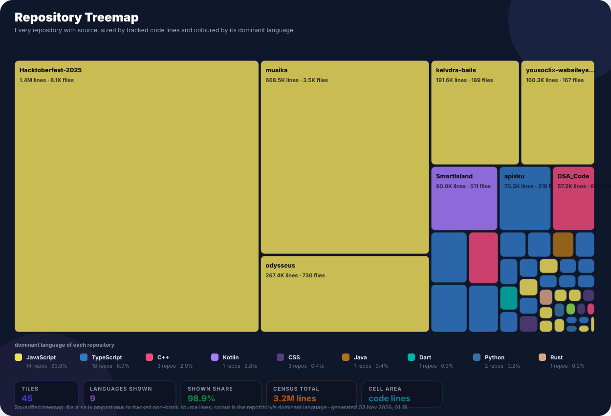

</div>

> Repository distribution from the same verified Code Census snapshot.

---

## Contribution Activity

<div align="center">

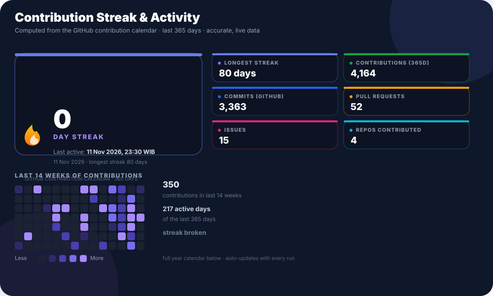

<br />
<br />

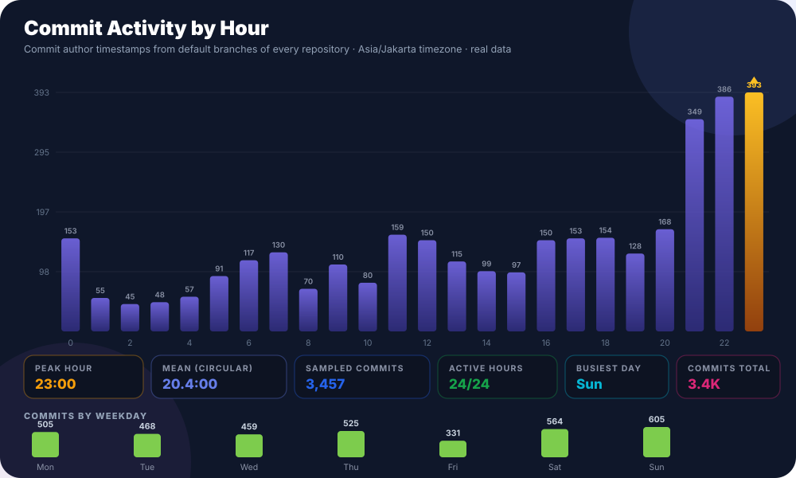

<br />
<br />

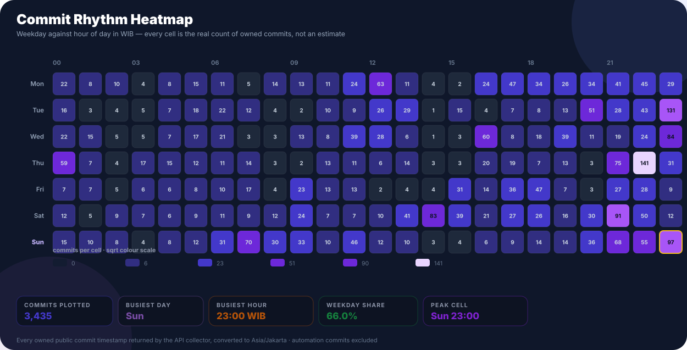

<br />
<br />

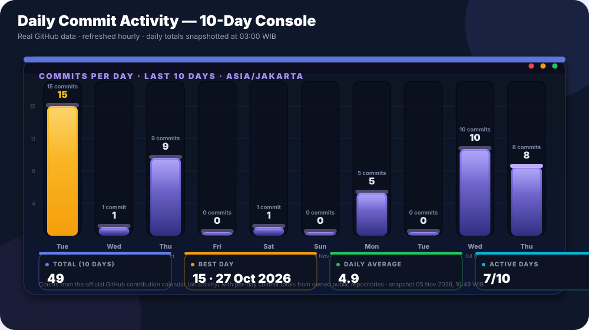

<br />
<br />

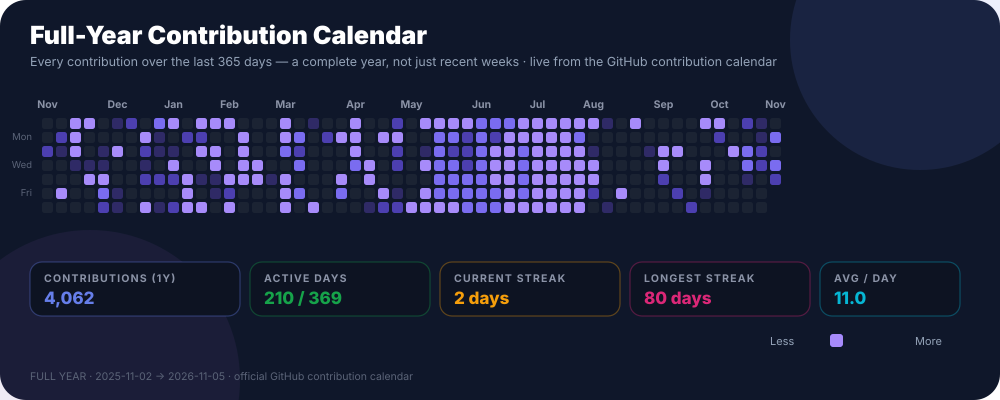

</div>

<p align="center">
  <a href="https://github.com/akaanakbaik"></a>&nbsp;
  <a href="https://github.com/akaanakbaik"></a>&nbsp;
  <a href="https://github.com/akaanakbaik"></a>&nbsp;
  <a href="https://github.com/akaanakbaik"></a>&nbsp;
  <a href="https://github.com/akaanakbaik"></a>
  <a href="https://github.com/akaanakbaik"></a>&nbsp;
</p>

> Contributions: GitHub calendar · Commit activity: public history, Asia/Jakarta time · Automation excluded where identifiable.

---

## Coding Age & Rhythm

<div align="center">

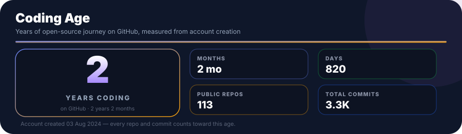

<br />
<br />

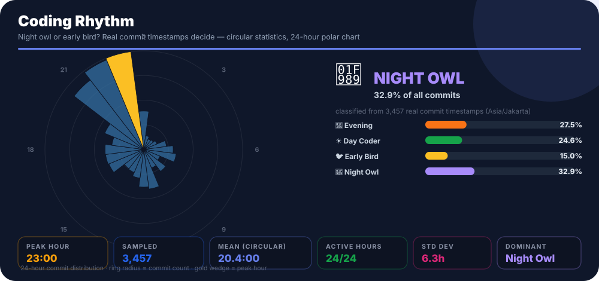

</div>

---

## Jakarta Time & Motivation

<div align="center">

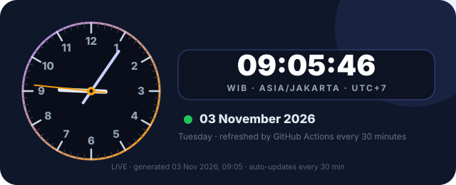

<br />

<a href="https://github.com/akaanakbaik"></a>&nbsp;
<a href="https://github.com/akaanakbaik"></a>

<br />
<br />

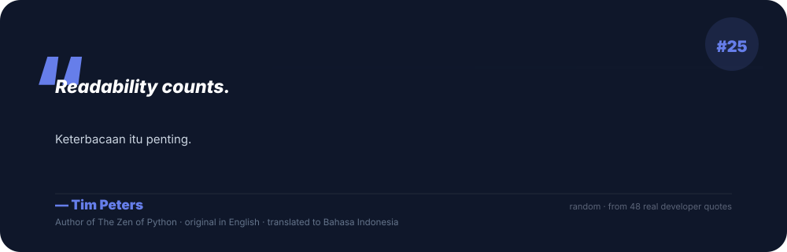

</div>

> Snapshot time (Asia/Jakarta); not a continuously running clock.

---

## Dynamic Repository Ranking

<div align="center">

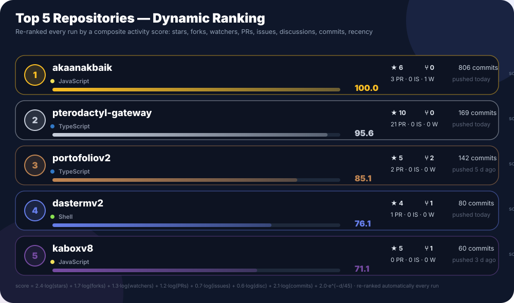

</div>

> Activity-based ranking, not an official popularity score.

---

## Featured Projects

<div align="center">

<table>
  <tr>
    <td align="center" width="33%">
      <a href="https://github.com/akaanakbaik/portofoliov2">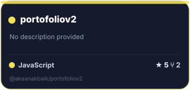</a>
    </td>
    <td align="center" width="33%">
      <a href="https://github.com/akaanakbaik/dastermv2">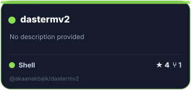</a>
    </td>
    <td align="center" width="33%">
      <a href="https://github.com/akaanakbaik/musika">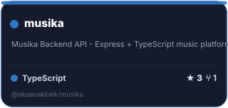</a>
    </td>
  </tr>
</table>

</div>

---

## Repository Stack Scan

<div align="center">

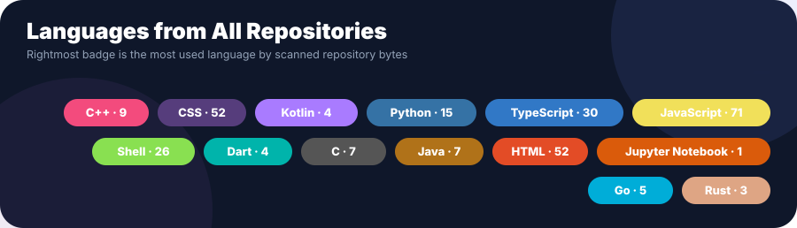

<br />
<br />

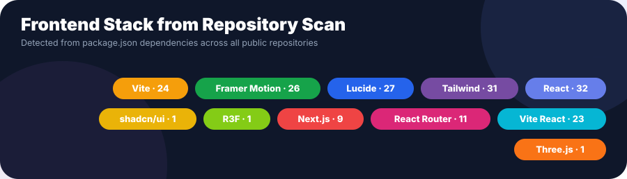

<br />
<br />

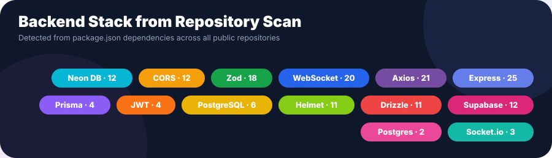

</div>

---

## Monthly Activity

<div align="center">

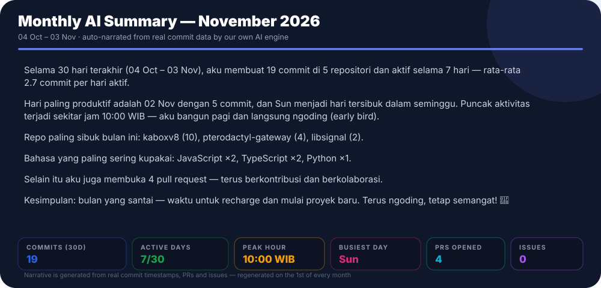

<br />

<a href="https://github.com/akaanakbaik"></a>&nbsp;
<a href="https://github.com/akaanakbaik"></a>&nbsp;
<a href="https://github.com/akaanakbaik"></a>

</div>

> Rolling 30-day activity · Asia/Jakarta · Last verified snapshot.

---

## Contribution Snake

<p align="center">
  <picture>
    <source media="(prefers-color-scheme: dark)" srcset="https://raw.githubusercontent.com/akaanakbaik/akaanakbaik/output/github-contribution-grid-snake-dark.svg" />
    <source media="(prefers-color-scheme: light)" srcset="https://raw.githubusercontent.com/akaanakbaik/akaanakbaik/output/github-contribution-grid-snake.svg" />
    
  </picture>
</p>

---

## Currently

```text
Working on   → Music Player Web App, Portfolio v2, Linux tools, AI tools, and bot systems
Learning     → React, Node.js, TypeScript, Docker, Cloud, DevOps, and AI Agents
Ask me about → JavaScript, Web Development, UI/UX, Linux, VPS, bots, and automation
```

<div align="center">


<sub>Made with ❤️ by Aka</sub>

</div>
